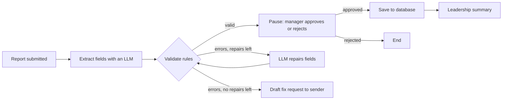

# Report Intake Agent

A LangGraph agent that takes in quarterly program reports, extracts and validates the key fields, repairs what it can, sends the rest back to the sender, and waits for a manager's approval before saving the report and writing a summary for leadership.

# Expected Outputs
Extraction

Rejection

Acceptance & Approval


## How it works



- **State** carries the report, its fields, the errors and the decision from step to step.
- **Conditional edges** loop back for repairs (up to two) or return the report to its sender.
- **Human in the loop:** `interrupt()` pauses the run at the approval step. The pause is saved in SQLite, so the run survives a restart and resumes when someone clicks Approve or Reject.
- **Any OpenAI-compatible model:** Ollama (local), NVIDIA NIM, Gemini or OpenAI, chosen in `.env`. No code changes.

## Run it

```bash
python -m venv .venv && source .venv/bin/activate
pip install -r requirements.txt
cp .env.example .env            # pick a provider
ollama pull gpt-oss:20b         # if you use Ollama
set -a && source .env && set +a
uvicorn app.main:app --reload   # open http://localhost:8000
```

Paste a file from `sample_reports/` into the form. One is valid after repair (it waits for approval); the other is missing an email (it goes back to the sender).

No model handy? `LLM_PROVIDER=fake` runs the same graph with a rule-based stand-in.

## Tests

```bash
LLM_PROVIDER=fake pytest -q
```

## Files

- `app/graph.py`: the LangGraph graph (nodes, edges, approval pause)
- `app/llm.py`: OpenAI-compatible client and the rule-based stand-in
- `app/store.py`: SQLite tables for submissions and approved reports
- `app/main.py`: FastAPI web page for submitting and approving

## Connect Gmail (optional)

Reports can arrive by email instead of the web form. The agent reads unread emails labelled `reports`, runs them through the same graph, replies to the sender in the same thread when something is missing, and emails the leadership summary after approval. Replies are saved as **drafts** until you set `GMAIL_SEND=true`.

1. Go to console.cloud.google.com, create a project, and enable the **Gmail API**.
2. **OAuth consent screen:** External, add your own address as a test user.
3. **Credentials → Create credentials → OAuth client ID → Desktop app.** Download the JSON and save it as `credentials.json` in this folder. It is git-ignored.
4. In Gmail, create a label `reports` and a filter that applies it (for example, subject contains "Quarterly report").
5. Run `python -m app.gmail`. The first run opens a browser to log in; after that it checks every minute.

Keep the web app running in another terminal to approve reports. Approvals there trigger the summary email.
